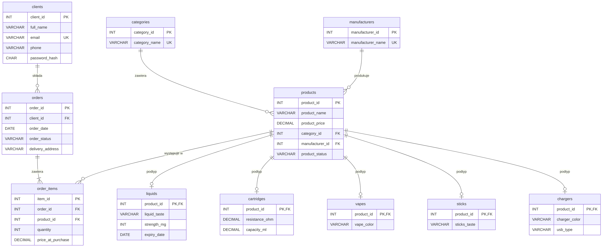

# Vape Shop Database — relacyjna baza danych sklepu internetowego (MySQL)

🇵🇱 Polski | [🇬🇧 English](README_EN.md)


Projekt relacyjnej bazy danych dla sklepu internetowego z e-papierosami i akcesoriami: od modelu ER i normalizacji, przez implementację w MySQL, po zapytania analityczne odpowiadające na pytania biznesowe (bestsellery, sezonowość, klienci VIP, ryzyka magazynowe).

> Projekt powstał jako praca zaliczeniowa z przedmiotu **Systemy baz danych** (Informatyka, Collegium Da Vinci, Poznań, styczeń 2026), a następnie został dopracowany do portfolio.

---

## Spis treści

- [Najważniejsze wnioski](#najważniejsze-wnioski)
- [Struktura repozytorium](#struktura-repozytorium)
- [Model danych](#model-danych)
- [Decyzje projektowe](#decyzje-projektowe)
- [Jak uruchomić](#jak-uruchomić)
- [Analizy](#analizy)
- [Scenariusze administracyjne](#scenariusze-administracyjne)
- [Dalszy rozwój](#dalszy-rozwój)

---

## Najważniejsze wnioski

Na podstawie danych testowych (30 zamówień, 03.2025–01.2026):

- **Vapes to prawie połowa przychodu (49,5%)**, choć sprzedano tylko 14 sztuk. **Liquids** mają najwięcej sprzedanych sztuk (22), ale dają 30,8% przychodu — to produkt „częstego zakupu”.
- **Styczeń 2026 = 55% całego przychodu** (15 z 27 zrealizowanych zamówień). Średnia wartość zamówienia w całym okresie: **127,94 zł**.
- **10% zamówień zostało anulowanych** (3 z 30).
- **Kategoria Sticks prawie się nie sprzedaje**: 1 sprzedana sztuka, jeden produkt niedostępny, drugi na wyczerpaniu — kandydat do przeglądu asortymentu.
- **Ryzyko magazynowe**: *Tobacco Classic 30ml* jest przeterminowany, a nadal ma status `in_stock` — do natychmiastowego wycofania. *Peach Ice 30ml* traci ważność za mniej niż 90 dni i nie miał ani jednej sprzedaży — kandydat do promocji.

---

## Struktura repozytorium

```
vape-shop-database/
├── sql/
│   ├── 01_schema.sql             # tabele, klucze, ograniczenia, indeksy, widok
│   ├── 02_seed_data.sql          # dane testowe (fikcyjne)
│   ├── 03_analytics_queries.sql  # 8 zapytań analitycznych
│   └── 04_admin_scenarios.sql    # CREATE / GRANT / INSERT / UPDATE / DELETE
├── docs/
│   ├── er_diagram.png            # diagram ER
│   └── er_diagram.mmd            # źródło diagramu (Mermaid)
├── README.md
└── README_EN.md
```

---

## Model danych



**11 tabel + 1 widok:**

| Grupa | Tabele | Opis |
|---|---|---|
| Słowniki | `categories`, `manufacturers` | kategorie i producenci |
| Klienci | `clients` | dane klientów, hasło jako hash bcrypt |
| Katalog | `products` | wspólne atrybuty każdego produktu |
| Podtypy produktów | `liquids`, `cartridges`, `vapes`, `sticks`, `chargers` | atrybuty specyficzne dla typu (np. moc liquidu, rezystancja grzałki) |
| Sprzedaż | `orders`, `order_items` | nagłówek zamówienia i jego pozycje |
| Widok | `v_order_totals` | wartość i liczba sztuk każdego zamówienia |

**Relacje:**

| Relacja | Typ | Przykład |
|---|---|---|
| `categories` → `products` | 1 : N | kategoria „Liquids” ma 7 produktów |
| `manufacturers` → `products` | 1 : N | Vaporesso dostarcza 4 produkty |
| `clients` → `orders` | 1 : N | klient składa wiele zamówień |
| `orders` → `order_items` | 1 : N | zamówienie zawiera kilka pozycji |
| `products` → `order_items` | 1 : N | produkt występuje w wielu zamówieniach |
| `products` → podtypy | 1 : 0..1 | produkt nr 2 jest liquidem, więc ma wiersz w `liquids` |

**Dane testowe:** 165 rekordów — 15 klientów, 27 produktów w 5 kategoriach, 8 producentów, 30 zamówień, 53 pozycje.

---

## Decyzje projektowe

1. **Nadtyp / podtypy produktów.** Wspólne kolumny są w `products`, a cechy specyficzne dla typu — w osobnych tabelach (`liquids`, `vapes`, …). Dzięki temu w `products` nie ma kolumn, które dla większości wierszy byłyby puste (np. `expiry_date` dla ładowarki). W tabelach podtypów `product_id` jest jednocześnie kluczem głównym i obcym, co wymusza relację 1 : 0..1.

2. **Normalizacja do 3NF.**
   - *1NF* — wartości atomowe: smak, moc i termin ważności liquidu to osobne kolumny; moc przechowywana jako liczba (`strength_mg`), a nie tekst „6mg”.
   - *2NF* — szczegóły pozycji (`quantity`, `price_at_purchase`) są w `order_items`, a nie w `orders`.
   - *3NF* — nazwy kategorii i producentów są w osobnych tabelach słownikowych.

3. **Wartość zamówienia liczona, a nie przechowywana.** Zamiast kolumny `order_price` w `orders` jest widok `v_order_totals`, który sumuje `quantity * price_at_purchase`. Przechowywanie wartości wyliczalnej grozi niespójnością: suma w nagłówku może nie zgadzać się z pozycjami.

4. **`price_at_purchase`.** Cena w momencie zakupu jest zapisywana w pozycji zamówienia, więc późniejsza zmiana ceny katalogowej (np. promocja) nie zmienia historii sprzedaży.

5. **Integralność danych w bazie, a nie tylko w aplikacji:**
   - 10 kluczy obcych; `ON DELETE CASCADE` dla podtypów i pozycji zamówienia, `RESTRICT` dla produktów występujących w zamówieniach;
   - `CHECK` dla statusów, cen, ilości i oceny (1–5);
   - `UNIQUE` dla e-maila klienta i pary (zamówienie, produkt);
   - `DECIMAL(10,2)` dla kwot zamiast `FLOAT`/`REAL` (brak błędów zaokrągleń).

6. **Indeksy** na kolumnach najczęściej używanych w filtrach analiz: `orders(order_date)`, `orders(order_status)`, `products(product_status)`, `liquids(expiry_date)`.

7. **Bezpieczeństwo i prywatność.** Hasła przechowywane jako hash bcrypt. Wszystkie dane osobowe są fikcyjne (domena `example.com`). Użytkownik `analyst` nie ma dostępu do tabeli `clients`.

---

## Jak uruchomić

Wymagania: **MySQL 8.0+** (`CHECK` działa od wersji 8.0.16).

```bash
git clone https://github.com/<twoj-login>/vape-shop-database.git
cd vape-shop-database

mysql -u root -p < sql/01_schema.sql
mysql -u root -p < sql/02_seed_data.sql
mysql -u root -p < sql/03_analytics_queries.sql
mysql -u root -p < sql/04_admin_scenarios.sql
```

Można też otworzyć pliki po kolei w MySQL Workbench lub phpMyAdmin i wykonać je w tej samej kolejności. Skrypty są idempotentne: `01_schema.sql` usuwa i tworzy tabele od nowa.

---

## Analizy

Pełny kod: [`sql/03_analytics_queries.sql`](sql/03_analytics_queries.sql). Przychód = `quantity * price_at_purchase`; zamówienia anulowane są wykluczone.

### 1. TOP-10 produktów
*Które produkty sprzedają się najlepiej?*

| product_name | category | units_sold | orders | revenue |
|---|---|--:|--:|--:|
| Strawberry Banana 60ml | Liquids | 5 | 4 | 274.95 |
| 0.8 ohm Mesh Coil | Cartridges | 5 | 3 | 49.95 |
| Vanilla Custard 50ml | Liquids | 4 | 3 | 179.96 |
| Blueberry Frost 30ml | Liquids | 4 | 3 | 136.46 |
| XROS Pod 0.6 ohm | Cartridges | 4 | 2 | 51.96 |
| Voopoo Drag 4 177W | Vapes | 3 | 3 | 659.97 |
| Aegis Solo 100W | Vapes | 3 | 3 | 599.97 |
| … | | | | |

**Wniosek:** liderzy ilościowi (liquidy, grzałki) i liderzy przychodowi (urządzenia) to różne produkty. Voopoo Drag 4 przy 3 sztukach daje więcej przychodu niż cała kategoria Cartridges.

### 2. Produkty bez sprzedaży
*Który towar nigdy nie trafił do zamówienia?*

| product_id | product_name | category | price | status |
|--:|---|---|--:|---|
| 27 | Wireless Charging Dock | Chargers | 59.99 | discontinued |
| 24 | Multiple USB Charger | Chargers | 49.99 | in_stock |
| 25 | Berry Mix Pods | Sticks | 36.99 | out_stock |
| 26 | Peach Ice 30ml | Liquids | 32.99 | in_stock |

**Wniosek:** 4 z 27 produktów (15%) nie mają żadnej sprzedaży; dwa z nich są dostępne w magazynie i zamrażają kapitał.

### 3. Ryzyko magazynowe: niski zapas i termin ważności
*Co domówić, a co szybko wyprzedać?* (stan na 02.11.2026 — zapytanie używa `CURDATE()`)

| product_name | status | stock_problem | expiry_date | days_to_expiry | expiry_problem |
|---|---|---|---|--:|---|
| Berry Mix Pods | out_stock | Brak | — | — | — |
| Menthol Pods 4-pack | low_stock | Mało | — | — | — |
| Tobacco Classic 30ml | in_stock | Dostępne | 2026-10-15 | -18 | Przeterminowany |
| Peach Ice 30ml | in_stock | Dostępne | 2026-12-20 | 48 | Upływa termin ważności |

**Wniosek:** przeterminowany produkt ma status `in_stock`, więc może zostać sprzedany — potrzebna reguła (np. zadanie cykliczne), która automatycznie zmienia status po dacie ważności.

### 4. Sprzedaż według miesięcy
*Jak zmieniają się liczba zamówień, średnia wartość zamówienia i przychód?*

| month | orders | avg_order_value | revenue |
|---|--:|--:|--:|
| 2025-03 | 4 | 163.86 | 655.43 |
| 2025-06 | 1 | 159.97 | 159.97 |
| 2025-07 | 1 | 45.96 | 45.96 |
| 2025-08 | 1 | 69.99 | 69.99 |
| 2025-09 | 1 | 264.97 | 264.97 |
| 2025-10 | 1 | 124.97 | 124.97 |
| 2025-11 | 1 | 79.99 | 79.99 |
| 2025-12 | 2 | 72.49 | 144.98 |
| 2026-01 | 15 | 127.21 | 1908.15 |

**Wniosek:** wyraźny skok w styczniu 2026 (55% przychodu). W kwietniu i maju 2025 nie było żadnej sprzedaży.

### 5. Producenci: szerokość oferty i poziom cen

| manufacturer | products | categories | avg_price |
|---|--:|--:|--:|
| LiquidWorld | 7 | 1 | 46.85 |
| Xiaomi | 6 | 1 | 37.49 |
| Juul Labs | 4 | 1 | 57.49 |
| Vaporesso | 4 | 2 | 45.49 |
| GeekVape | 3 | 2 | 85.32 |
| OXVA / Uwell / Voopoo | 1 | 1 | 52.99 / 41.99 / 219.99 |

**Wniosek:** wszystkie liquidy pochodzą od jednego dostawcy (LiquidWorld) — ryzyko uzależnienia od dostawcy.

### 6. Dni z najwyższym przychodem (TOP-5)

| order_date | orders | revenue |
|---|--:|--:|
| 2026-01-25 | 3 | 559.92 |
| 2026-01-10 | 2 | 379.96 |
| 2026-01-20 | 2 | 274.95 |
| 2026-01-15 | 2 | 264.98 |
| 2025-09-20 | 1 | 264.97 |

### 7. Najcenniejsi klienci (TOP-5)
*Kto powinien trafić do programu lojalnościowego?*

| client | orders | total_spent | avg_order | first_purchase | last_purchase |
|---|--:|--:|--:|---|---|
| Marek Jankowski | 2 | 469.93 | 234.97 | 2026-01-10 | 2026-01-25 |
| Michał Zieliński | 2 | 444.94 | 222.47 | 2025-09-20 | 2026-01-25 |
| Olena Kovalenko | 2 | 318.43 | 159.22 | 2025-06-17 | 2026-01-28 |
| Kamil Kozłowski | 2 | 274.98 | 137.49 | 2025-12-24 | 2026-01-15 |
| Tomasz Kamiński | 2 | 258.97 | 129.49 | 2025-03-16 | 2026-01-27 |

**Wniosek:** o pozycji w rankingu decyduje wartość koszyka, a nie liczba zakupów — klienci VIP kupują urządzenia (Vapes).

### 8. Przychód według kategorii

| category | orders | items_sold | revenue | udział |
|---|--:|--:|--:|--:|
| Vapes | 13 | 14 | 1709.86 | 49.5% |
| Liquids | 10 | 22 | 1063.28 | 30.8% |
| Cartridges | 8 | 15 | 398.85 | 11.5% |
| Chargers | 6 | 7 | 202.43 | 5.9% |
| Sticks | 1 | 1 | 79.99 | 2.3% |

---

## Scenariusze administracyjne

Plik: [`sql/04_admin_scenarios.sql`](sql/04_admin_scenarios.sql)

| # | Scenariusz | Polecenia | Co pokazuje |
|---|---|---|---|
| 1 | Tabela opinii `reviews` | `CREATE TABLE`, `INSERT` | rozbudowa schematu bez zmian w istniejących tabelach |
| 2 | Użytkownik `analyst` tylko do odczytu | `CREATE USER`, `GRANT SELECT` | zasada najmniejszych uprawnień, brak dostępu do danych osobowych |
| 3 | Nowi producenci | `INSERT` | rozszerzenie słownika |
| 4 | Promocja -10% na liquidy | `ALTER TABLE`, `START TRANSACTION`, `UPDATE`, `COMMIT` | transakcja z kontrolą przed zatwierdzeniem; `ALTER TABLE` przed transakcją, bo w MySQL powoduje niejawny `COMMIT` |
| 5 | Wycofanie produktów | `DELETE`, `UPDATE` | produkt bez sprzedaży jest usuwany, sprzedany — archiwizowany; klucz obcy blokuje usunięcie produktu z historią zamówień |

---

## Dalszy rozwój

- Zautomatyzowanie statusów (np. `EVENT` zmieniający status przeterminowanych liquidów, trigger aktualizujący stan magazynu).
- Tabele `inventory` (stany magazynowe), `payments`, `shipments`, `promotions`.
- Analizy z użyciem CTE i funkcji okna (udział w przychodzie, ranking, retencja klientów).
- Dashboard w Power BI na podstawie tej bazy.

---

## Autor

**Kseniya Lankovskaya** — studentka Informatyki (Collegium Da Vinci, Poznań), zainteresowana analizą danych i SQL.
