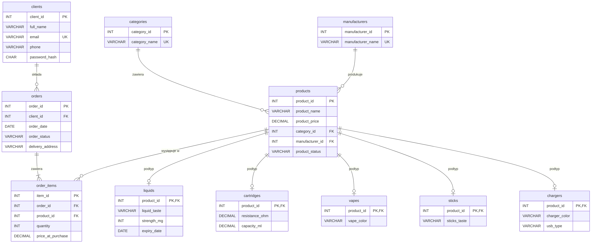

# Vape Shop Database — relational database for an online store (MySQL)

[🇵🇱 Polski](README.md) | 🇬🇧 English


A relational database for an online store selling e-cigarettes and accessories: ER model and normalization, MySQL implementation, and analytical queries that answer business questions (best sellers, seasonality, VIP customers, inventory risks).

> Originally built as the final project for the **Database Systems** course (Computer Science, Collegium Da Vinci, Poznań, January 2026), then refined for my portfolio. Full documentation with all query results is in Polish in [README.md](README.md).

## Key findings

Based on the test data (30 orders, Mar 2025 – Jan 2026):

- **Vapes bring almost half of the revenue (49.5%)** with only 14 units sold. **Liquids** lead in units (22) but account for 30.8% of revenue — a frequent-purchase product.
- **January 2026 = 55% of total revenue** (15 of 27 completed orders). Average order value: **127.94 PLN**.
- **10% of orders were cancelled** (3 of 30).
- **The Sticks category barely sells**: 1 unit sold, one product out of stock, another running low.
- **Inventory risk**: *Tobacco Classic 30ml* is past its expiry date but still marked `in_stock`; *Peach Ice 30ml* expires in under 90 days and has never been sold — a promotion candidate.
- **All liquids come from one supplier** — supplier concentration risk.

## Repository structure

```
sql/01_schema.sql             tables, keys, constraints, indexes, view
sql/02_seed_data.sql          test data (fictional)
sql/03_analytics_queries.sql  8 analytical queries
sql/04_admin_scenarios.sql    CREATE / GRANT / INSERT / UPDATE / DELETE
docs/er_diagram.png           ER diagram (source: er_diagram.mmd, Mermaid)
```

## Data model



11 tables + 1 view: lookup tables (`categories`, `manufacturers`), `clients`, the `products` supertype with five subtype tables (`liquids`, `cartridges`, `vapes`, `sticks`, `chargers`), sales (`orders`, `order_items`) and the `v_order_totals` view. Test data: 165 rows.

## Design decisions

1. **Supertype / subtype** — shared columns live in `products`, type-specific ones in subtype tables, so `products` has no mostly-empty columns. In subtypes `product_id` is both PK and FK (1 : 0..1 relationship).
2. **3NF** — atomic values (e.g. nicotine strength stored as a number, `strength_mg`), order line details in `order_items`, categories and manufacturers in lookup tables.
3. **Order total is calculated, not stored** — the `v_order_totals` view sums `quantity * price_at_purchase`, so the header can never disagree with its line items.
4. **`price_at_purchase`** keeps sales history correct when list prices change.
5. **Integrity enforced in the database** — 10 foreign keys (`CASCADE` for subtypes and order lines, `RESTRICT` for products that have been sold), `CHECK` constraints for statuses, prices, quantities and ratings, `UNIQUE` e-mail, `DECIMAL(10,2)` for money.
6. **Indexes** on the columns used in analytical filters (order date and status, product status, expiry date).
7. **Security & privacy** — bcrypt password hashes, fictional personal data (`example.com`), a read-only `analyst` user with no access to the `clients` table.

## How to run

Requires **MySQL 8.0.16+**.

```bash
mysql -u root -p < sql/01_schema.sql
mysql -u root -p < sql/02_seed_data.sql
mysql -u root -p < sql/03_analytics_queries.sql
mysql -u root -p < sql/04_admin_scenarios.sql
```

## Analytical queries

| # | Business question |
|---|---|
| 1 | Top 10 products by units sold and revenue |
| 2 | Products that have never been sold |
| 3 | Inventory risk: low/no stock and liquids close to expiry |
| 4 | Monthly orders, average order value and revenue |
| 5 | Manufacturers: assortment breadth and average price |
| 6 | Top 5 revenue days |
| 7 | Top 5 customers by total spend |
| 8 | Revenue by category |

## Admin scenarios

New `reviews` table · read-only `analyst` user (`GRANT SELECT`) · new manufacturers (`INSERT`) · 10% liquid discount inside a transaction (`ALTER TABLE` placed before `START TRANSACTION`, since DDL causes an implicit commit in MySQL) · discontinued products: delete if never sold, archive otherwise (the FK blocks deleting a product with order history).

## Next steps

Automated status updates (`EVENT` / triggers), `inventory`, `payments`, `shipments` tables, CTE and window-function analyses, a Power BI dashboard.

## Author

**Kseniya Lankovskaya** — Computer Science student (Collegium Da Vinci, Poznań), interested in data analysis and SQL.
